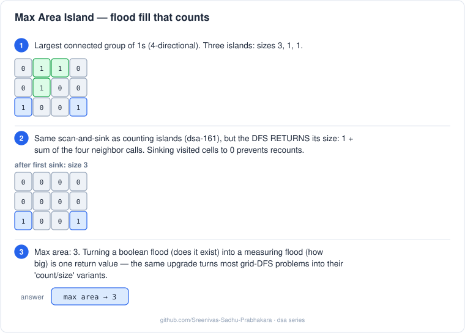

# Max Area of Island

> NeetCode 150 · Graphs — number-of-islands where the flood-fill returns its size: 1 plus whatever the four recursive arms sank. Go, stdlib only, tested.

## Problem

The size of the largest 4-connected group of 1s in a binary grid (0 for an all-water grid).

## Approach

One mutation to dsa-161's island counter: the sinking DFS *returns a count* — `1 + sum of the four arms` — instead of returning nothing, and the outer scan keeps the max instead of incrementing. The sink-as-you-count still guarantees each cell contributes once. This counting-flood-fill is the shape to recognize: island perimeter, lake volume, and region-label problems are all this traversal with a different quantity accumulated through the return value.

**Complexity:** O(R·C) time; recursion up to the island size.

## Visual walkthrough

Read the picture top to bottom — each numbered frame is one moment of the algorithm
running on this repo's test example.

## Run

    go test ./...   # verify
    go run .        # demo

---

Part of a 275-repo DSA series in Go — Striver's SDE Sheet (dsa-001–191) plus the NeetCode 150 / Blind 75 additions (dsa-192–275), stdlib only, every solution tested. Browse: [`dsa-*` repos](https://github.com/Sreenivas-Sadhu-Prabhakara?tab=repositories&q=dsa-&type=source).
